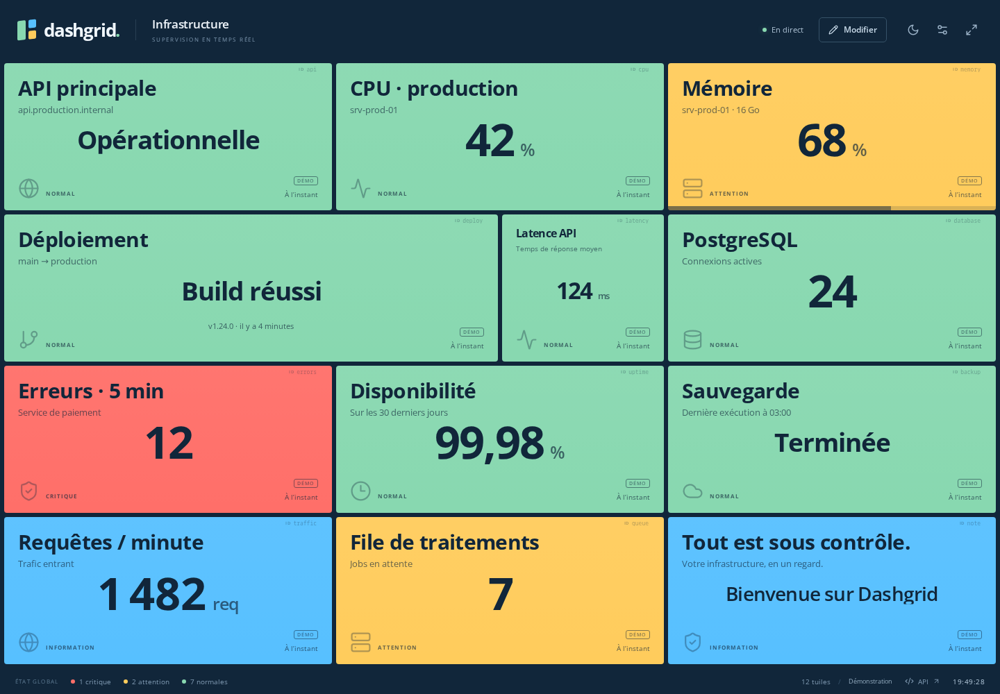
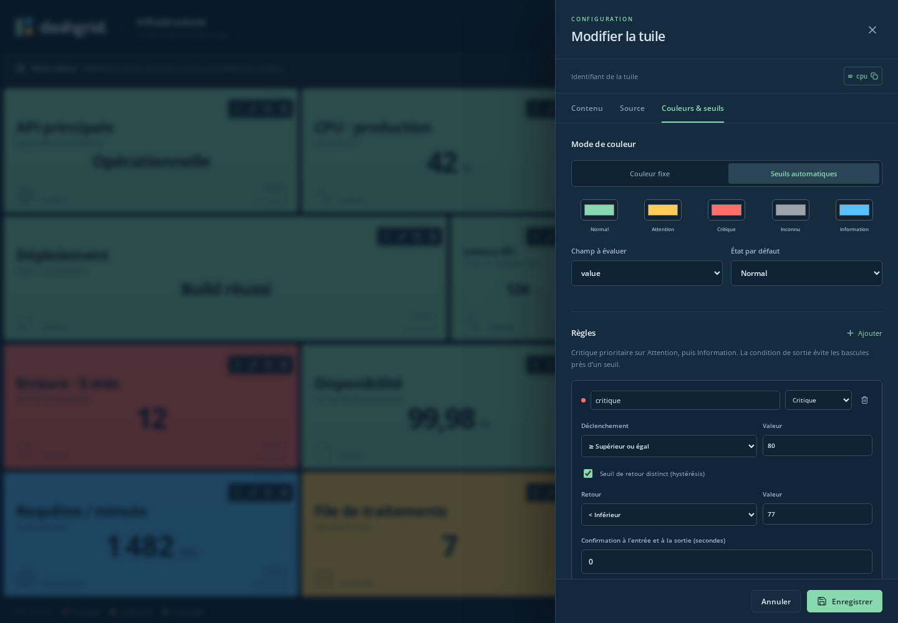

# Dashgrid

A Docker-ready monitoring wallboard inspired by [Monitoror](https://demo.monitoror.com/).
Arrange tiles visually, send data through a REST API, and use thresholds to change
tile colors automatically.

[Documentation en français](docs/README.fr.md)



## Features

- Full-screen grid with pastel and dark outline themes.
- Drag-and-drop editing, tile resizing, duplication, and configurable positions.
- Metric, text, status, and progress tiles with visible, copyable IDs.
- Push updates through the API or scheduled HTTP JSON collection.
- Server-side thresholds with priorities, hysteresis, confirmation delays, and stale-data detection.
- Live updates shared across screens using Server-Sent Events (SSE).
- SQLite persistence and a single Docker container with a persistent volume.
- Self-hosted fonts and assets, with no external resources required by the interface.
- French-language interface and interactive OpenAPI documentation.

## Quick start

Requirements: Docker Engine and the Docker Compose plugin.

```bash
docker compose up -d --build
```

| Resource                      | Address                               |
| ----------------------------- | ------------------------------------- |
| Dashboard                     | <http://localhost:8080>               |
| Interactive API documentation | <http://localhost:8080/api/docs>      |
| OpenAPI JSON                  | <http://localhost:8080/api/docs/json> |
| Health endpoint               | <http://localhost:8080/api/health>    |

The first start creates **12 synthetic demo tiles**. Their `DÉMO` badges distinguish
them from real measurements. Saving a tile in the editor or pushing data to it
turns off its demo behavior.

### Configuration

Create a `.env` file using `.env.example` as a template:

```dotenv
DASHGRID_BIND=127.0.0.1
DASHGRID_PORT=8080
DASHGRID_API_KEY=
```

| Variable           | Default     | Purpose                                                                                         |
| ------------------ | ----------- | ----------------------------------------------------------------------------------------------- |
| `DASHGRID_BIND`    | `127.0.0.1` | Host interface used to publish the container; use your LAN or VPN IP for remote access.         |
| `DASHGRID_PORT`    | `8080`      | Published HTTP port.                                                                            |
| `DASHGRID_API_KEY` | Empty       | Optional bearer token required for all write requests. The dashboard stays readable without it. |

Apply configuration changes with `docker compose up -d`.

The backend also accepts `PORT` and `DATABASE_PATH` when running outside Docker.
By default, local development stores data in `data/dashgrid.sqlite`.

## Using the dashboard

Click **Modifier** to enter edit mode. Use a tile's pencil button to edit its
content, source, colors, and rules. Drag its handle to move it, or resize from the
bottom-right corner. Dropping a tile onto one of the same dimensions swaps them.

Tile IDs appear discreetly in the top-right corner. Click an ID to copy it for use
in API requests. The configuration panel also keeps the ID visible above its tabs.



### Restore demo tiles

To bring back deleted examples in an existing installation:

```bash
docker compose stop dashgrid
docker compose run --rm --no-deps dashgrid npm run demo:restore
docker compose up -d --wait
```

The command backs up the database under `/data/backups/`, then adds missing demo
tiles to available positions. It expands the grid if necessary and preserves
existing tiles and their data. Running it again does not create duplicates.

For a local installation, stop the application and run `npm run demo:restore`
after building. The same `DATABASE_PATH` setting must be used for both commands.

## API examples

All endpoints use the `/api/v1` prefix. Add an `Authorization: Bearer YOUR_KEY`
header to write requests if an API key is configured.

Push a measurement to the demo CPU tile:

```bash
curl -X POST http://localhost:8080/api/v1/tiles/cpu/data \
  -H 'Content-Type: application/json' \
  -d '{"value":83,"status":"up","message":"High CPU load"}'
```

Change its title and use a fixed color:

```bash
curl -X PATCH http://localhost:8080/api/v1/tiles/cpu \
  -H 'Content-Type: application/json' \
  -d '{"content":{"title":"Production CPU"},"appearance":{"mode":"fixed","fixedColor":"#57c0ff"}}'
```

| Method               | Endpoint               | Purpose                                                       |
| -------------------- | ---------------------- | ------------------------------------------------------------- |
| GET / PATCH          | `/dashboard`           | Read or configure the dashboard.                              |
| POST                 | `/tiles`               | Create a tile.                                                |
| GET / PATCH / DELETE | `/tiles/:id`           | Read, configure, or remove a tile.                            |
| POST                 | `/tiles/:id/duplicate` | Duplicate a tile into a new position.                         |
| PUT                  | `/layout`              | Save multiple positions atomically.                           |
| POST                 | `/tiles/:id/data`      | Replace a push tile's measurement.                            |
| POST                 | `/tiles/:id/preview`   | Test a threshold configuration without saving.                |
| GET                  | `/events`              | Subscribe to the initial snapshot and subsequent SSE updates. |

Coordinates `x` and `y` are zero-based in the API; `w` and `h` are cell counts.
Configuration PATCH requests merge objects; rule arrays and HTTP header maps are
replaced when supplied. Each data update replaces the previous measurement.
HTTP collection supports dot paths and array indexes, such as `metrics.cpu` or
`servers[0].status`. HTTP authentication headers stay on the server and are masked
in responses.

See the [French reference](docs/README.fr.md#api) and the interactive API docs for
complete payloads, HTTP collection, and concurrency control with `If-Match`.

## Thresholds

Each tile supports a fixed color or automatic colors based on server-calculated
states. A typical CPU setup is:

| State    | Enter when                              | Recover when                | Default color |
| -------- | --------------------------------------- | --------------------------- | ------------- |
| Normal   | No alert applies                        | —                           | Green         |
| Warning  | CPU ≥ 60%                               | CPU < 55%                   | Amber         |
| Critical | CPU ≥ 80%                               | CPU < 75%                   | Red           |
| Unknown  | Missing, invalid, failed, or stale data | A valid measurement arrives | Gray          |

Critical rules outrank warnings, which outrank informational rules. Separate
entry and exit conditions prevent color flickering around a boundary. Optional
confirmation delays require fresh measurements; silence does not confirm an
alert. The last value remains visible when data expires.

See [threshold configuration](docs/README.fr.md#seuils) for a complete example.

## Persistence and updates

The `dashgrid_data` volume contains the SQLite database, including configuration,
source settings, positions, rules, and the last known measurements.

```bash
docker compose up -d --build
docker compose ps
docker compose logs --tail=100 dashgrid
```

`docker compose down` keeps the volume. Adding `--volumes` removes its data.
To create a consistent backup:

```bash
docker compose stop dashgrid
docker compose cp dashgrid:/data ./dashgrid-backup
docker compose start dashgrid
```

## Development

Use Node.js **22.16+**. If you use nvm, run `nvm use` first.

```bash
npm ci
npm run dev
```

The frontend runs at <http://localhost:5173> and proxies API requests to port 8080.

```bash
npm run format:check
npm run check
npm test
npm run build
npx playwright install chromium
npm run test:e2e
```

Tests use temporary or in-memory databases. Browser screenshots and traces are
written to the ignored `test-results/` directory. GitHub Actions checks formatting,
types, API and threshold behavior, browser workflows, and the Docker build.

See [CONTRIBUTING.md](CONTRIBUTING.md) for the contribution workflow.

## Project layout

```text
server/       REST API, HTTP collection, thresholds, SQLite, and demo restoration
shared/       Shared types and validation schemas
web/          React dashboard and visual editor
tests/        API, threshold, demo, and browser tests
docs/         French documentation
Dockerfile    Multi-stage production image
compose.yaml  Single-service deployment with persistent storage
```

## License and acknowledgments

Dashgrid is licensed under the [MIT license](LICENSE). It is an independent
implementation inspired by Monitoror's visual design. Open Sans is bundled
locally through Fontsource; dependency license notices remain with their packages.
